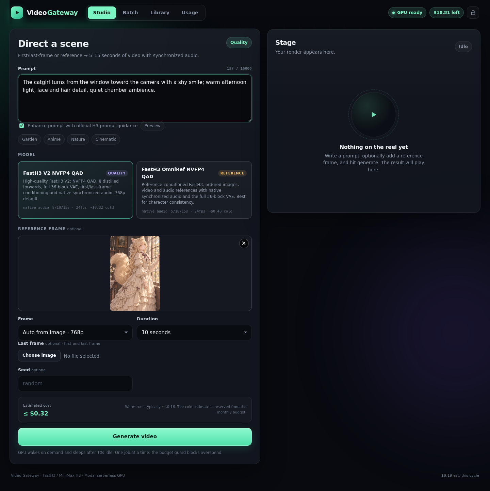
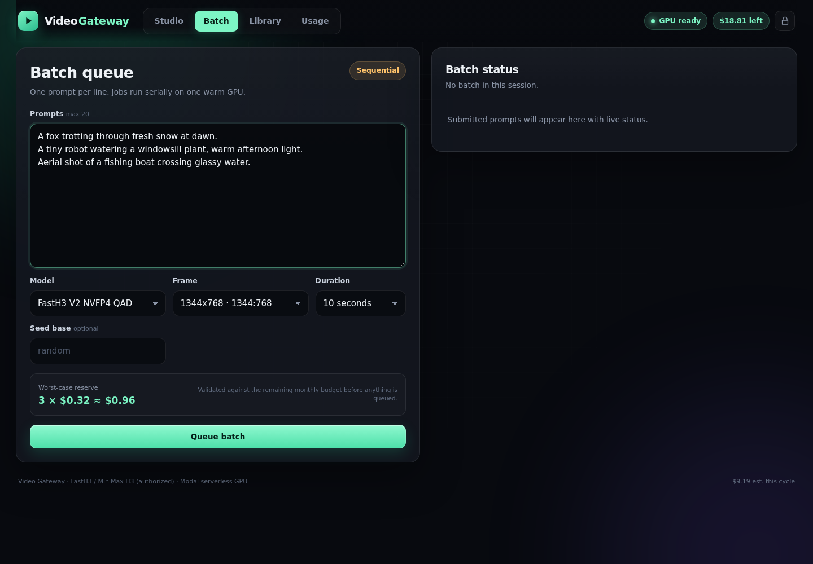
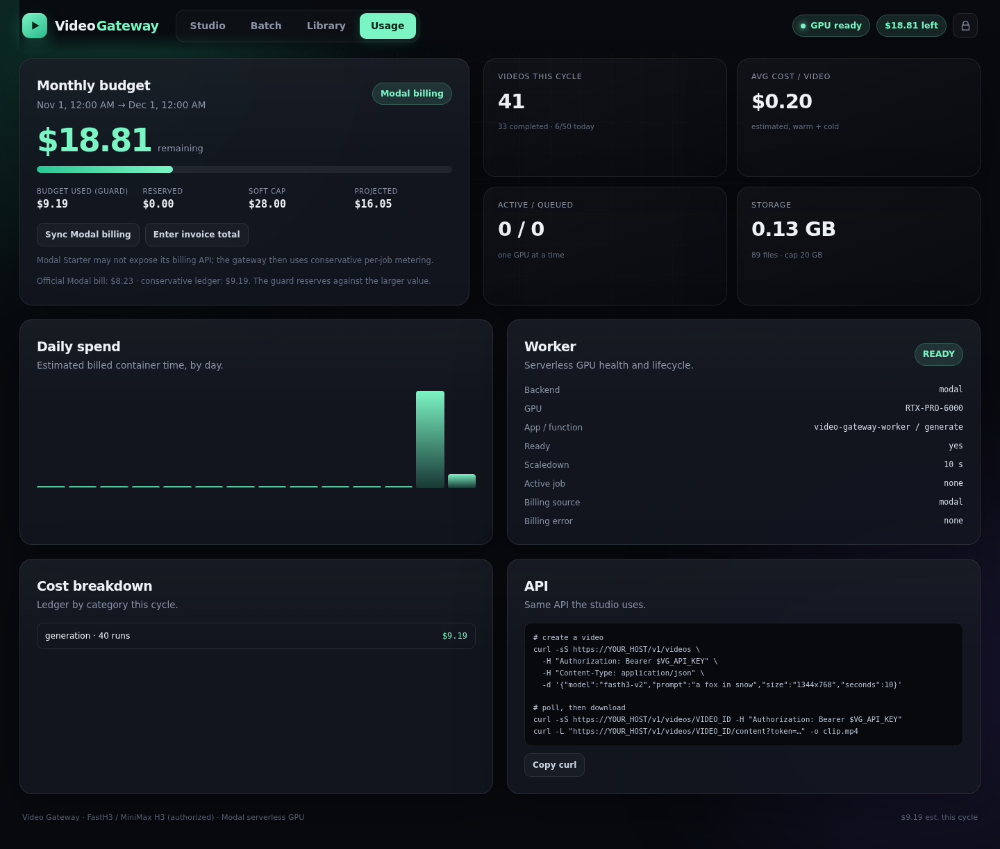
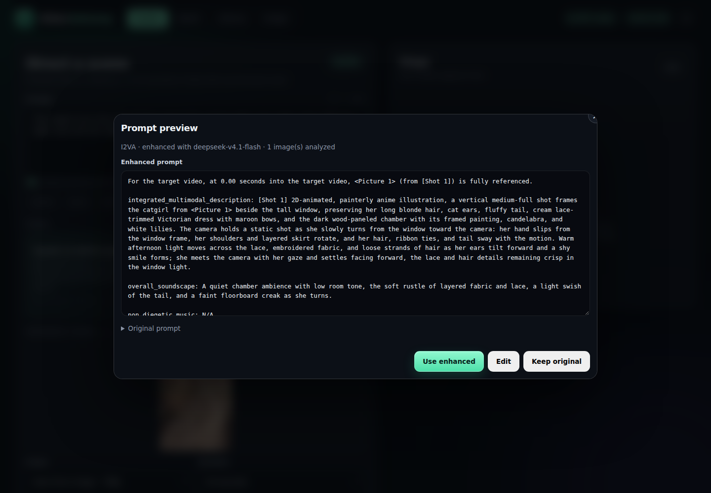
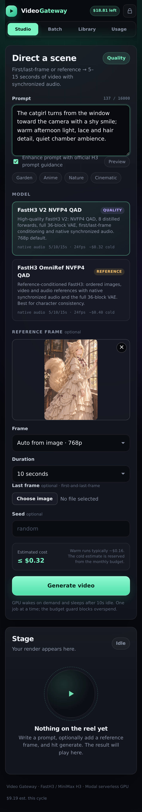
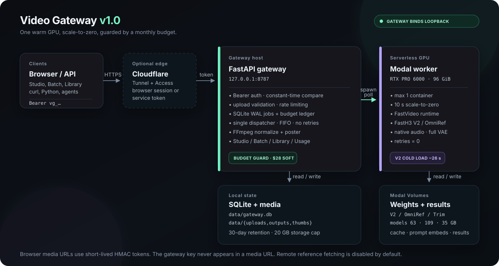

# Video Gateway

**English** · [简体中文](README.zh-CN.md)

A self-hosted, budget-aware video studio for **MiniMax H3 / FastH3** on
serverless [Modal](https://modal.com) GPUs. It combines an OpenAI-style
asynchronous API with a focused web workbench for text-to-video, keyframe I2V,
first/last-frame and ordered-reference generation.

Most video-generation demos assume a persistent GPU and a hosted queue. Video
Gateway takes the opposite approach: a small, auditable control plane that keeps
one GPU warm only while work exists, makes every paid job explicit, and survives
restarts without resubmitting work.

**Release:** `v1.1.0` · **Code license:** MIT · **Model license:** see
[Licenses](#licenses-and-attribution) · **Release notes:**
[docs/RELEASE_NOTES.md](docs/RELEASE_NOTES.md)



> The reference deployment is validated on the RTX PRO 6000 96 GB profile.
> Docker support is included as a template but is **not tested** for v1.0.0.
> See [Limitations](#limitations) before choosing a deployment path.

**Jump to:** [Demo](#demo) · [Features](#features) · [Quick start](#quick-start) ·
[Architecture](#architecture) · [Benchmarks](#benchmarks) · [API](#api) ·
[Agent Skill](#agent-skill) · [Limitations](#limitations)

## Demo

These are frames from real generated clips on the reference deployment, not
mockups. The catgirl and portrait reference images were supplied by the project
owner and are included with permission; see
[`docs/media/`](docs/media/README.md) for usage and replacement guidance.

| Reference input | Generated result |
|---|---|
|  |  |
| Catgirl character · first-frame I2V | 768×1152 · 10 s · frame from generated clip |
|  |  |
| Portrait · first-frame I2V | 768×1024 · 10 s · frame from generated clip |

Both clips use `fasth3-v2`, first-frame I2V, an adaptive 768p canvas, 10 seconds,
seed `20261118` and `enhance_prompt=false` with hand-authored I2VA prompts.
`fasth3-v2` is used because both demos are single-image conditioning; OmniRef is
reserved for multi-reference shots. The exact prompts and parameters are in
[`docs/media/README.md`](docs/media/README.md) and
[`docs/media/prompts/`](docs/media/prompts/). The full MP4s are intentionally
not stored in Git; add 5–15 second clips and matching posters under
[`docs/media/`](docs/media/README.md).

<details>
<summary><strong>More UI screenshots</strong></summary>

| Batch queue | Usage and budget |
|---|---|
|  |  |

| Prompt preview | Mobile Studio |
|---|---|
|  |  |

</details>

## Features

- **Four conditioning modes** on `fasth3-v2`: text-to-video, first-frame I2V,
  first-and-last-frame and last-frame-only; image inputs also support adaptive
  aspect ratio.
- **Ordered OmniRef references** on `fasth3-omniref`: up to 9 images, 3 videos
  and 3 audio clips, with native audio.
- **Quality-first defaults:** adaptive 768p, 10 seconds, full 36-block VAE,
  8 distilled forwards and native synchronized audio.
- **5/10/15 second clips** at 480p/768p; adaptive canvases are snapped to H3's
  32-pixel grid without a forced 16:9 crop.
- **Official H3 prompt structure** for T2VA, I2VA, FL2VA, L2VA and Ref2VA.
  Prompt enhancement can be previewed, edited or bypassed; the original prompt
  is retained.
- **Studio, Batch, Library, Usage and API** views with Range playback,
  downloads, cancellation, retry and desktop/mobile layouts.
- **Budget guard and crash-safe queue:** cold-start reservations, official
  billing sync where available, conservative ledger fallback and no automatic
  retries.
- **Portable agent skill:** OpenCode/Codex-compatible instructions, official
  prompt references, curl examples and a dependency-free Python client.

## Quick start

### Local demo — no GPU, no Modal account

The local backend exercises the real API, queue, FFmpeg path and UI with a
synthetic test pattern. It is labelled **DEMO** in the UI and `/healthz`.

```bash
git clone https://github.com/John-Ferrel/video-gateway.git
cd video-gateway

make dev
API_KEYS=local-dev-key make local
```

Open <http://127.0.0.1:8787> and enter `local-dev-key`. Press `Ctrl+C` to stop.

<details>
<summary>Manual local setup</summary>

```bash
python3 -m venv .venv
.venv/bin/pip install -r requirements-dev.txt
cp .env.example .env
VIDEO_BACKEND=local API_KEYS=local-dev-key .venv/bin/python -m gateway.main
```

If `API_KEYS` is empty, the first start writes a random key to
`data/api_key` (mode `0600`). Never commit `.env` or `data/`.

</details>

### Modal deployment — the verified path

Prerequisites: Python 3.11+, a Modal account and enough credits for the chosen
GPU. The reference profile uses `RTX-PRO-6000` with 96 GiB GPU memory.

```bash
# 1. Install the gateway and authenticate the Modal CLI
python3 -m venv .venv
.venv/bin/pip install -r requirements.txt
.venv/bin/modal token set --token-id ak-... --token-secret as-...

# 2. Download the non-experimental FastH3 checkpoints to a Modal Volume
#    (CPU-only, no GPU charge; about 207 GB for V2 + OmniRef + hidden Trim)
.venv/bin/modal run worker/modal_app.py --action prepare

# 3. Build/deploy the GPU function and verify it
.venv/bin/modal deploy worker/modal_app.py
.venv/bin/modal run worker/modal_app.py --action status
```

Set the gateway to the real backend:

```dotenv
# .env
VIDEO_BACKEND=modal
PUBLIC_BASE_URL=https://video.example.com
```

Start it with the included systemd user service:

```bash
scripts/install_vps.sh
systemctl --user status video-gateway
```

The worker image compiles the matching H3 NVFP4 prefix-split kernel. Model
downloads and image builds do not allocate a billed GPU. The worker is pinned to
`retries=0`, `min_containers=0`, `max_containers=1`, `buffer_containers=0` and
`scaledown_window=10`.

> **Docker status:** `Dockerfile` and `docker-compose.yml` are provided for
> convenience but were **not built or tested** for v1.0.0. The systemd path is
> the verified reference deployment. If you use Docker, validate the image,
> FFmpeg build, volume permissions and Access/Tunnel integration yourself.

### Configuration

All deployment-specific values live in `.env` or the process environment. See
[`.env.example`](.env.example) and
[docs/OPERATIONS.md](docs/OPERATIONS.md) for the complete reference.

| Variable | Default | Purpose |
|---|---|---|
| `VIDEO_BACKEND` | `auto` | `modal`, local demo, or auto-detect |
| `API_KEYS` | generated file | Comma-separated keys; each slot has its own library; first slot is admin |
| `PUBLIC_BASE_URL` | empty | Public origin used in API/media URLs |
| `MONTHLY_CREDITS_USD` / `MONTHLY_SOFT_BUDGET_USD` | `30` / `28` | Displayed credits and admission ceiling |
| `MAX_JOB_ESTIMATE_USD` | `0.75` | Reject a single job above this worst-case estimate |
| `MAX_UPLOAD_BYTES` | `12 MiB` | Image limit; video 32 MiB, audio 16 MiB |
| `RETENTION_DAYS` / `MAX_STORAGE_GB` | `30` / `20` | Media retention and storage cap |
| `H3_PROMPT_ENHANCER_*` | disabled unless set | Optional OpenAI-compatible prompt enhancer |
| `REGENERATE_HD_ENABLED` | `false` | Gate for the 2K refine endpoint |

Prompt enhancement is optional. Point the `H3_PROMPT_ENHANCER_*` variables at an
OpenAI-compatible chat endpoint; the example in `.env.example` uses
`deepseek-v4.1-flash`. If the endpoint is unavailable, generation falls back to
the written prompt.

### Multiple keys and shared budget

`API_KEYS` is a list of independent **library slots**. Each key can list, play,
cancel, retry and delete only its own videos and batches. The GPU queue, budget,
Usage page, storage cap and worker health are shared globally, so one key cannot
exhaust a separate quota and total spend remains bounded by the existing soft
budget.

The first key in the list is the admin key for billing sync, diagnostics,
events and cleanup. Replace a key value in place to keep its library; append a
new key for a new person. Media URLs remain short-lived capability URLs, so do
not forward them outside the intended user.

## Architecture



- The gateway binds `127.0.0.1:8787` by default. Put it behind a TLS reverse
  proxy or Cloudflare Tunnel; do not expose the port directly.
- SQLite WAL stores jobs, batches, upload provenance, the budget ledger,
  settings and lifecycle events.
- A single dispatcher persists the Modal call id before polling. After a restart
  it reattaches or checks the result Volume; it never automatically resubmits a
  job.
- Media lives under `data/{uploads,outputs,thumbs}`. Completed clips are
  normalized, given a poster, and served with Range support.
- The Modal worker has no gateway credentials. It reads FastH3 weights from a
  Modal Volume, writes the result MP4 to a results Volume, and exits after 10
  seconds idle.

More detail: [docs/ARCHITECTURE.md](docs/ARCHITECTURE.md).

## Benchmarks

Measured on **2026-11-17** on the reference deployment: one `RTX-PRO-6000`
(96 GB), 4 CPU, 96 GiB RAM, full 36-block VAE. Costs are gateway estimates from
measured worker wall time plus the scaledown tail, **not** a per-clip invoice.
Modal pricing and credits can change; re-check current rates before budgeting.

| Route | Conditioning | Worker time | Est. cost | Peak VRAM |
|---|---|---:|---:|---:|
| V2 I2V 1344×768, 10 s | first frame | 191 s | $0.249 | 68.5 GiB |
| V2 I2V 1344×768, 15 s | first frame | 255 s | $0.318 | 71.7 GiB |
| V2 FL2VA 1344×768, 5 s | first + last | 58 s warm | $0.084 | 71.7 GiB |
| V2 I2V 768×1344, 5 s | adaptive portrait | 76 s | $0.119 | 56.9 GiB |
| OmniRef 1344×768, 10 s | 2 ordered images | 244 s | $0.307 | 78.8 GiB |
| OmniRef 1344×768, 15 s | 2 ordered images | 353 s | $0.426 | 85.2 GiB |

All advertised routes completed without OOM on the 96 GB card. The worker
stream-copies the H.264/yuv420p video and only re-encodes audio, so the final file
is not subjected to a second lossy video generation. Full stage timings, quality
notes and the earlier 5-second matrix are in
[docs/BENCHMARK.md](docs/BENCHMARK.md).

**Official cumulative billing for the validation exercise:** **$8.23 metered**,
**$7.69 credits used**, **$0.00 billed**. This includes earlier H3 experiments
and is not a per-clip price. At the benchmark snapshot, the gateway's
conservative ledger was $9.19; the guard reserves against the larger of official
and estimated spend. The workspace kept its existing **$30 credits / $28 soft
budget** and no spending limit was raised. The two later demo-only clips added
about **$0.35** to the gateway ledger and are not included in the $8.23 figure.

## API

All `/v1` and `/usage` routes require `Authorization: Bearer $VG_API_KEY`.
Media URLs returned by the API carry a short-lived, purpose-scoped HMAC token so
they work in `<video>`/`` tags without exposing the API key.

```bash
export BASE_URL=http://127.0.0.1:8787
export VG_API_KEY="$(cat data/api_key)"   # or your configured key

# Text to video
curl -sS "$BASE_URL/v1/videos" \
  -H "Authorization: Bearer $VG_API_KEY" \
  -H "Content-Type: application/json" \
  -d '{"model":"fasth3-v2","prompt":"A red panda walks through a misty bamboo forest, cinematic morning light.","size":"auto","seconds":10,"seed":42}'

# First-frame I2V (multipart)
curl -sS "$BASE_URL/v1/videos" \
  -H "Authorization: Bearer $VG_API_KEY" \
  -F model=fasth3-v2 \
  --form-string 'prompt=The character turns toward the camera and smiles; rain and city ambience.' \
  -F size=auto -F seconds=10 \
  -F input_reference=@reference.jpg

# Poll, then download the completed clip
curl -sS "$BASE_URL/v1/videos/VIDEO_ID" \
  -H "Authorization: Bearer $VG_API_KEY"
curl -L "$BASE_URL/v1/videos/VIDEO_ID/content?download=1&token=..." -o clip.mp4
```

Use `--form-string` for text containing semicolons; plain `curl -F 'prompt=a; b'`
truncates at the semicolon.

| Method | Path | Purpose |
|---|---|---|
| `GET` | `/v1/models` | Model capabilities, defaults and estimated costs |
| `POST` | `/v1/videos` | Create one job (JSON or multipart) |
| `POST` | `/v1/videos/batch` | Create up to 20 serialized jobs |
| `GET` | `/v1/videos/{id}` | Status, progress, cost and media URLs |
| `GET` | `/v1/videos/{id}/content` | MP4 with Range support |
| `POST` | `/v1/videos/{id}/cancel` | Cancel a queued/running job |
| `POST` | `/v1/videos/{id}/retry` | Explicit new billable job |
| `DELETE` | `/v1/videos/{id}` | Delete a finished record and files |
| `GET` | `/usage` | Budget, spend, storage and worker health |

FL2VA, OmniRef, prompt preview and admin request/response examples are in
[docs/API.md](docs/API.md).

## Agent Skill

[`skills/video-gateway/SKILL.md`](skills/video-gateway/SKILL.md) is a portable
skill for OpenCode, Codex and other compatible agents. It covers route choice,
official H3 prompt modes, reference uploads, asynchronous jobs, polling,
downloads and spending discipline. The accompanying
[`scripts/video_gateway.py`](skills/video-gateway/scripts/video_gateway.py) is a
standard-library-only client with no automatic retries.

```bash
# OpenCode
mkdir -p ~/.config/opencode/skills
ln -s "$PWD/skills/video-gateway" ~/.config/opencode/skills/video-gateway

# Codex
mkdir -p ~/.codex/skills
ln -s "$PWD/skills/video-gateway" ~/.codex/skills/video-gateway

export VIDEO_GATEWAY_BASE_URL="https://video.example.com"
export VIDEO_GATEWAY_API_KEY="vg_..."
python skills/video-gateway/scripts/video_gateway.py models
```

When Cloudflare Access is enabled, also set `CF_ACCESS_CLIENT_ID` and
`CF_ACCESS_CLIENT_SECRET`. The script reads credentials only from the
environment (or `VIDEO_GATEWAY_API_KEY_FILE`); it never writes them into the
repository and never retries a paid generation by itself.

## Cloudflare Access

Cloudflare is optional but supported. The recommended public setup is a named
Tunnel to `http://127.0.0.1:8787` plus a Self-hosted Access application with an
email/SSO policy for the browser. API clients use an Access **service token**:

```bash
curl "$BASE_URL/v1/models" \
  -H "CF-Access-Client-Id: $CF_ACCESS_CLIENT_ID" \
  -H "CF-Access-Client-Secret: $CF_ACCESS_CLIENT_SECRET" \
  -H "Authorization: Bearer $VG_API_KEY"
```

Access is an outer identity layer and does **not** replace the gateway Bearer
key. Do not disable Access or add an unauthenticated bypass without a deliberate
decision. Setup, verification and the manual Access check are documented in
[docs/OPERATIONS.md](docs/OPERATIONS.md).

## Security

- Bearer keys are compared in constant time; every route except `/healthz`, `/`
  and static assets requires authentication.
- Content and thumbnail URLs use purpose-scoped HMAC tokens with a one-hour
  default TTL. An API key is never placed in a media URL.
- Images are size-limited, decoded with Pillow, re-encoded and stored under
  random UUID paths. SVG and malformed images are rejected.
- Remote reference fetching is disabled by default. When enabled, only public
  http(s) hosts are accepted and every redirect hop is checked for
  private/link-local/loopback addresses.
- There is no CORS middleware; cross-origin browser calls are not enabled by
  default.
- The gateway binds loopback, and the systemd unit only grants write access to
  `data/`. `.env`, `data/`, logs and model caches are ignored by Git.

## Limitations

- **Regenerate HD / 2K is disabled.** Open-H3-Regenerate-2K requires roughly
  150 GiB of GPU memory and a 164.9 GB checkpoint; the 96 GiB worker cannot
  admit it. The endpoint returns a clear 503 with `regenerate_hd_unavailable`.
- **OmniRef continuation is not exposed.** It needs overlap trim, audio mux and
  child-asset lifecycle work; see [docs/CONTINUATION.md](docs/CONTINUATION.md).
- **One GPU, one job at a time.** This is intentional for warm-cache reuse and
  predictable spending. It is not a multi-tenant render farm.
- **Only the 96 GB RTX PRO 6000 profile was validated.** Other GPU types,
  multi-GPU serving and higher-resolution profiles were not tested.
- **Docker deployment is untested.** The systemd/Modal path is the verified
  reference deployment; Docker files are convenience templates.
- **No 1080p mode.** The released 2K pipeline is fixed at 2560×1440 and silent;
  the gateway does not fake an upscale.
- **Prompt enhancement is best-effort and external.** It analyzes still images;
  video/audio references are represented by labels only.
- **Model quality is not claimed to match commercial video services.** The
  measured trade-offs are documented above.

## Project layout

```text
gateway/          FastAPI app, SQLite, dispatcher, Modal client, static UI
gateway/prompts/  Vendored official H3 prompt-writing guides
worker/           Modal app: CPU weights download + RTX PRO 6000 generate
skills/           Portable agent skill and dependency-free HTTP client
tests/            API, budget, cleanup, recovery and prompt tests
deploy/           systemd unit template
docs/             API, architecture, operations, benchmark, media and release notes
scripts/          deploy, install, benchmark, smoke and Cloudflare checks
```

## Development

```bash
make dev
make test
make lint
node --check gateway/static/app.js
```

The full suite covers API auth and validation, budget admission, dispatcher
recovery, Cloudflare behavior, prompt-mode selection and worker request
building. The local backend is an end-to-end path: it generates an MP4 with
FFmpeg, writes a result, transcodes it, makes a poster, enforces the queue and
serves Range requests.

Reference verification: **44 tests passed**, Ruff clean and a desktop/mobile
browser audit with no console errors or horizontal overflow. The public snapshot
uses the same validated code. Two additional 10 s V2 I2V jobs were run after the
code snapshot to produce the demo stills; they did not change the benchmark
table or the code.

## Licenses and attribution

The **gateway source code and documentation are MIT licensed**
([LICENSE](LICENSE)). Model weights are **not** included in this repository and
are governed by their upstream licenses. FastH3 QAD checkpoints are derivatives
of MiniMax H3; the MiniMax H3 Community License restricts the Applicable
Territory and includes acceptable-use and commercial terms. Read
[THIRD_PARTY_NOTICES.md](THIRD_PARTY_NOTICES.md) before deploying or
redistributing anything.

Key upstream projects and assets:

- [MiniMax H3](https://github.com/MiniMax-AI/MiniMax-H3) and the official
  [`h3-prompt-writing`](https://github.com/MiniMax-AI/MiniMax-H3/tree/main/skills/h3-prompt-writing)
  guides. The vendored guide texts remain under the upstream model license.
- [FastVideo](https://github.com/hao-ai-lab/FastVideo) (Apache-2.0) and the
  FastH3 QAD checkpoints on Hugging Face.
- [Modal](https://modal.com) for serverless GPU execution.
- The FastAPI, Uvicorn, Starlette, Pillow, HTTPX and FFmpeg communities.

Product names and trademarks belong to their respective owners. This project is
not endorsed by MiniMax, Modal, Cloudflare or the FastVideo maintainers.

---

[简体中文](README.zh-CN.md) · [Release notes](docs/RELEASE_NOTES.md) ·
[Screenshots](docs/screenshots/README.md) · [Demo media](docs/media/README.md)
