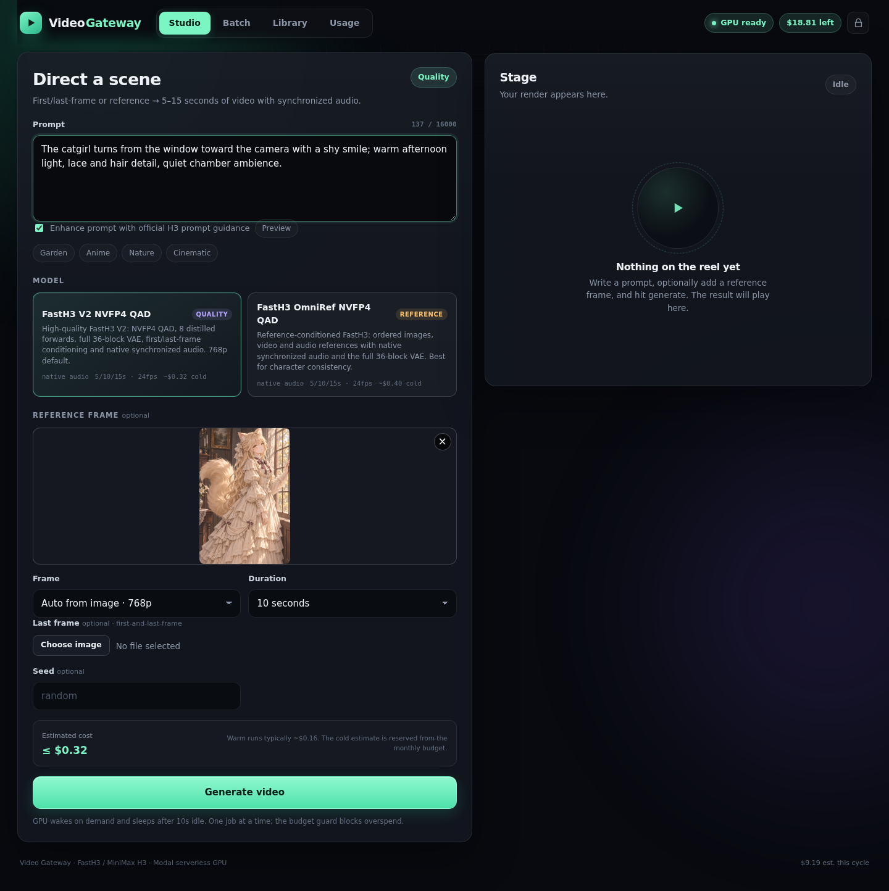
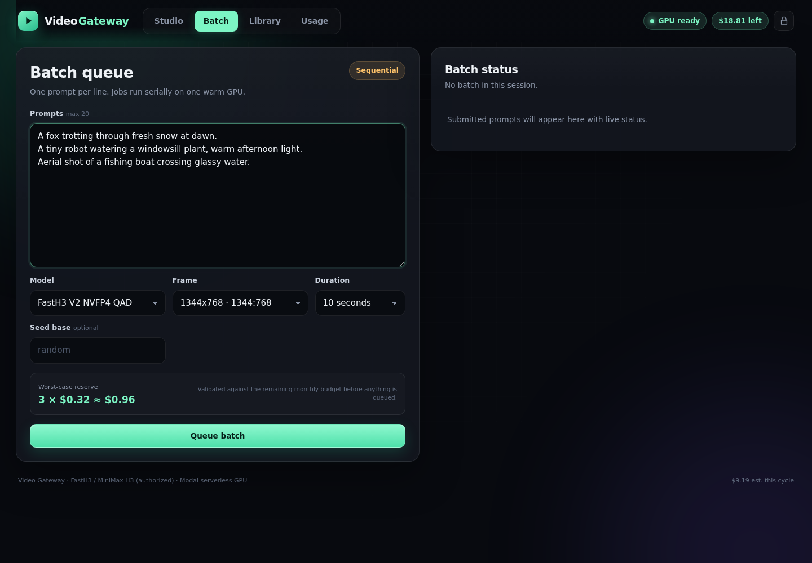
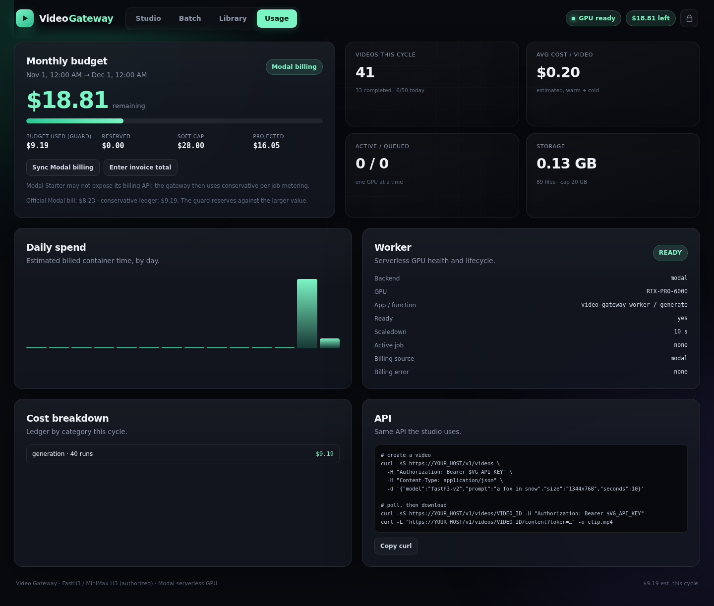
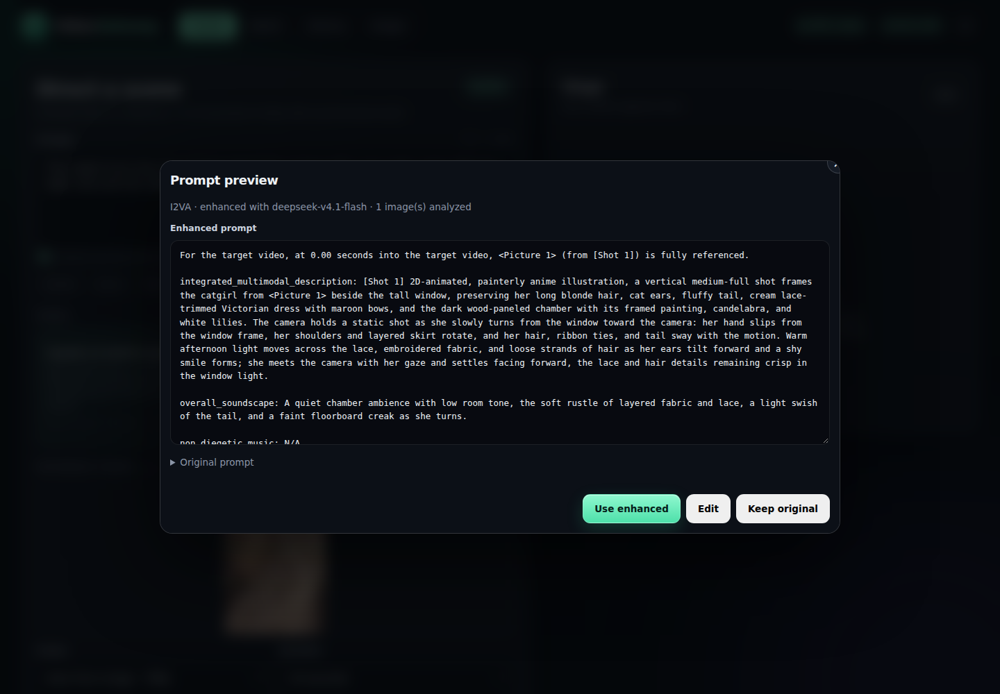
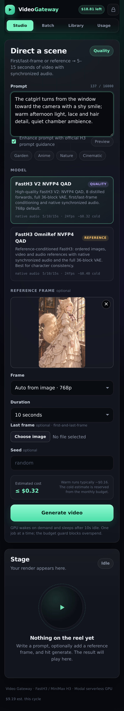
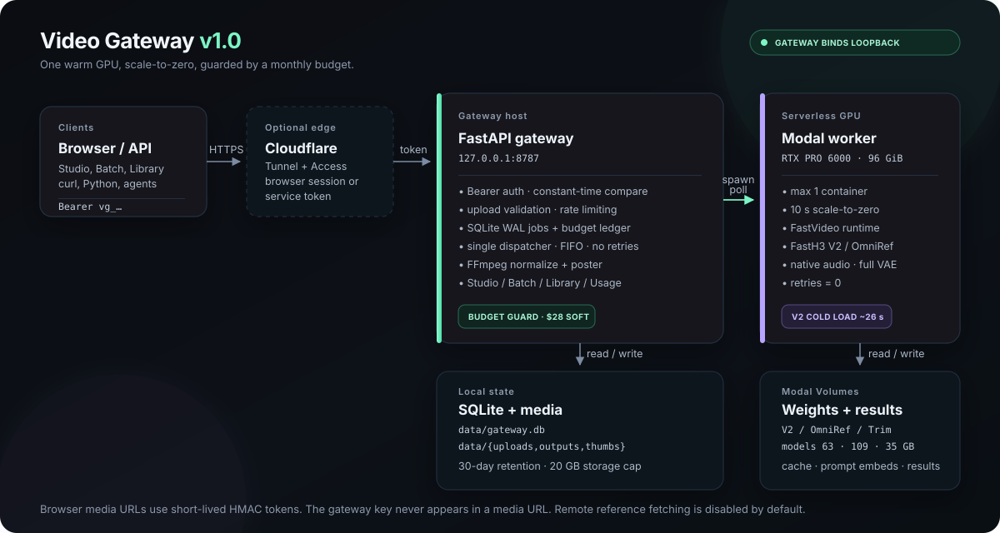

# Video Gateway

[English](README.md) · **简体中文**

一个自托管、预算可控的视频工作台，为 **MiniMax H3 / FastH3** 提供
OpenAI 风格的异步视频 API 和专注创作流程的 Web 界面。GPU 运行在
[Modal](https://modal.com) 的无服务器实例上，支持文生视频、首帧图生视频、
首尾帧和有序参考素材生成。

大多数视频生成演示默认需要常驻 GPU 和托管队列。Video Gateway 采用相反的做法：
一个足够小、可审计的控制面，只在有任务时保持单张 GPU 温暖；每个计费任务都明确可见，
进程重启也不会重复提交已提交的任务。

**版本：** `v1.1.0` · **代码许可证：** MIT · **模型许可证：** 见
[许可证与致谢](#许可证与致谢) · **发布说明：**
[docs/RELEASE_NOTES.md](docs/RELEASE_NOTES.md)



> 参考部署已在 RTX PRO 6000 96 GB 配置上验证。Docker 仅作为模板提供，
> v1.0.0 **没有构建或测试** Docker 部署。选择部署方式前请先看
> [已知限制](#已知限制)。

**快速跳转：** [演示](#演示) · [功能](#功能) · [快速开始](#快速开始) ·
[架构](#架构) · [基准](#基准) · [API](#api) · [Agent Skill](#agent-skill) ·
[已知限制](#已知限制)

## 演示

以下图片来自参考部署上真实生成的视频片段，不是静态 mockup。猫娘和真人参考图由项目
所有者提供并授权用于本仓库；使用和替换说明见 [`docs/media/`](docs/media/README.md)。

| 参考输入 | 生成结果 |
|---|---|
|  |  |
| 猫娘角色 · 首帧 I2V | 768×1152 · 10 秒 · 生成视频帧 |
|  |  |
| 真人肖像 · 首帧 I2V | 768×1024 · 10 秒 · 生成视频帧 |

两条演示都使用 `fasth3-v2`、首帧 I2V、自适应 768p、10 秒、固定 seed
`20261118`，并关闭自动增强，使用手写的 I2VA 提示词。两条都是单图条件生成，
所以选择 V2；OmniRef 留给多参考素材场景。完整提示词和参数见
[`docs/media/README.md`](docs/media/README.md) 与
[`docs/media/prompts/`](docs/media/prompts/)。完整 MP4 文件刻意不放进 Git；
把 5–15 秒的演示片段和对应封面放到 [`docs/media/`](docs/media/README.md)。

<details>
<summary><strong>更多界面截图</strong></summary>

| 批处理队列 | 用量与预算 |
|---|---|
|  |  |

| 提示词预览 | 移动端 Studio |
|---|---|
|  |  |

</details>

## 功能

- `fasth3-v2` 支持**四种条件模式**：文生视频、首帧 I2V、首尾帧、仅尾帧；
  图片输入还支持**自适应画幅**。
- `fasth3-omniref` 支持**有序参考素材**：最多 9 张图、3 段视频和 3 段音频，
  并生成原生同步音频。
- **质量优先默认值：** 自适应 768p、10 秒、完整 36 块 VAE、8 次蒸馏前向、
  原生同步音频。
- **5/10/15 秒**时长，480p/768p；自适应画布对齐 H3 的 32 像素网格，不强制裁成 16:9。
- **官方 H3 提示词结构：** T2VA、I2VA、FL2VA、L2VA、Ref2VA。提示词增强支持预览、
  编辑或跳过，原始提示词始终保留。
- **Studio、Batch、Library、Usage、API** 视图，支持 Range 播放、下载、取消、重试和
  桌面/移动端布局。
- **预算护栏与崩溃安全队列：** 冷启动预留、可用时同步官方账单、保守账本兜底，
  不自动重试。
- **可移植 Agent Skill：** 支持 OpenCode/Codex，包含官方提示词参考、curl 示例和
  零依赖 Python 客户端。

## 快速开始

### 本地演示 — 不需要 GPU 或 Modal 账号

本地后端通过真实 API、队列、FFmpeg 和 UI 路径生成一个合成测试画面。UI 和
`/healthz` 会明确标记 **DEMO**。

```bash
git clone https://github.com/John-Ferrel/video-gateway.git
cd video-gateway

make dev
API_KEYS=local-dev-key make local
```

打开 <http://127.0.0.1:8787>，输入 `local-dev-key`。按 `Ctrl+C` 停止。

<details>
<summary>手动本地启动</summary>

```bash
python3 -m venv .venv
.venv/bin/pip install -r requirements-dev.txt
cp .env.example .env
VIDEO_BACKEND=local API_KEYS=local-dev-key .venv/bin/python -m gateway.main
```

如果 `API_KEYS` 为空，首次启动会把随机密钥写入 `data/api_key`（权限 `0600`）。
不要提交 `.env` 或 `data/`。

</details>

### Modal 部署 — 已验证路径

前置条件：Python 3.11+、Modal 账号，以及所选 GPU 所需的额度。参考配置使用
`RTX-PRO-6000`，96 GiB 显存。

```bash
# 1. 安装网关依赖并登录 Modal CLI
python3 -m venv .venv
.venv/bin/pip install -r requirements.txt
.venv/bin/modal token set --token-id ak-... --token-secret as-...

# 2. 把非实验性 FastH3 checkpoint 下载到 Modal Volume
#    （仅 CPU，不产生 GPU 费用；V2 + OmniRef + 隐藏 Trim 约 207 GB）
.venv/bin/modal run worker/modal_app.py --action prepare

# 3. 构建并部署 GPU 函数，然后检查状态
.venv/bin/modal deploy worker/modal_app.py
.venv/bin/modal run worker/modal_app.py --action status
```

把网关切到真实后端：

```dotenv
# .env
VIDEO_BACKEND=modal
PUBLIC_BASE_URL=https://video.example.com
```

使用仓库内的 systemd 用户服务启动：

```bash
scripts/install_vps.sh
systemctl --user status video-gateway
```

Worker 镜像会编译匹配的 H3 NVFP4 prefix-split kernel。模型下载和镜像构建不会分配
计费 GPU。Worker 固定为 `retries=0`、`min_containers=0`、`max_containers=1`、
`buffer_containers=0`、`scaledown_window=10`。

> **Docker 状态：** `Dockerfile` 和 `docker-compose.yml` 仅作为便利模板提供，
> v1.0.0 **没有构建或测试** Docker 部署。经过验证的路径是 systemd 用户服务。
> 如果使用 Docker，请自行验证镜像、FFmpeg 构建、卷权限以及 Access/Tunnel 集成。

### 配置

所有部署相关值都来自 `.env` 或进程环境变量。完整参考见 [`.env.example`](.env.example)
和 [docs/OPERATIONS.md](docs/OPERATIONS.md)。

| 变量 | 默认值 | 用途 |
|---|---|---|
| `VIDEO_BACKEND` | `auto` | `modal`、本地演示或自动检测 |
| `API_KEYS` | 自动生成 | 逗号分隔的 key；每个槽位有独立素材库；第一个槽位是管理员 |
| `PUBLIC_BASE_URL` | 空 | API/媒体 URL 使用的公开源 |
| `MONTHLY_CREDITS_USD` / `MONTHLY_SOFT_BUDGET_USD` | `30` / `28` | 展示额度与准入软预算 |
| `MAX_JOB_ESTIMATE_USD` | `0.75` | 单任务最坏估算超过此值时拒绝 |
| `MAX_UPLOAD_BYTES` | `12 MiB` | 图片限制；视频 32 MiB、音频 16 MiB |
| `RETENTION_DAYS` / `MAX_STORAGE_GB` | `30` / `20` | 媒体保留期与存储上限 |
| `H3_PROMPT_ENHANCER_*` | 未设置即关闭 | 可选的 OpenAI 兼容提示词增强 |
| `REGENERATE_HD_ENABLED` | `false` | 2K refine 端点开关 |

提示词增强是可选的。把 `H3_PROMPT_ENHANCER_*` 指向一个 OpenAI 兼容聊天端点即可；
`.env.example` 中的示例使用 `deepseek-v4.1-flash`。服务不可用时，生成会回退到用户提示词。

### 多 key 与共享额度

`API_KEYS` 是独立的**素材库槽位**列表。每个 key 只能列出、播放、取消、重试和删除
自己的视频与批次。GPU 队列、预算、Usage、存储上限和 worker 状态全局共享，
因此每个 key 不能各自无限消耗，总支出仍受现有软预算约束。

列表中的第一个 key 是管理员 key，用于账单同步、诊断、事件和清理。替换某个槽位的
key 值可以保留该槽位的素材库；新增用户时在末尾追加新 key。媒体 URL 仍是短期
capability URL，不要转发给非预期用户。

## 架构



- 网关默认只监听 `127.0.0.1:8787`。请放在 TLS 反向代理或 Cloudflare Tunnel 后面，
  不要把端口直接暴露到公网。
- SQLite WAL 保存任务、批次、上传来源、预算账本、设置和生命周期事件。
- 单调度线程在轮询前持久化 Modal call id。重启后会重新挂接调用或检查结果 Volume，
  **不会自动重复提交**任务。
- 媒体保存在 `data/{uploads,outputs,thumbs}`；完成的视频会规范化、生成封面，并通过
  Range 请求提供播放。
- Modal worker 不持有网关凭据；它从 Modal Volume 读取 FastH3 权重，把结果 MP4 写入
  结果 Volume，并在最后一个任务结束 10 秒后退出。

更多细节：[docs/ARCHITECTURE.md](docs/ARCHITECTURE.md)。

## 基准

以下数据测于 **2026-11-17** 的参考部署：单台 `RTX-PRO-6000`（96 GB 显存）、
4 CPU、96 GiB 内存、完整 36 块 VAE。成本是网关根据实测 worker 运行时间与缩容尾段
估算的，**不是单条账单**。Modal 价格和额度可能变化，做预算前请重新核对。

| 路线 | 条件 | Worker 时间 | 估算成本 | 峰值显存 |
|---|---|---:|---:|---:|
| V2 I2V 1344×768，10 秒 | 首帧 | 191 秒 | $0.249 | 68.5 GiB |
| V2 I2V 1344×768，15 秒 | 首帧 | 255 秒 | $0.318 | 71.7 GiB |
| V2 FL2VA 1344×768，5 秒 | 首帧 + 尾帧 | 58 秒（热） | $0.084 | 71.7 GiB |
| V2 I2V 768×1344，5 秒 | 自适应竖屏 | 76 秒 | $0.119 | 56.9 GiB |
| OmniRef 1344×768，10 秒 | 2 张有序参考 | 244 秒 | $0.307 | 78.8 GiB |
| OmniRef 1344×768，15 秒 | 2 张有序参考 | 353 秒 | $0.426 | 85.2 GiB |

以上路线均在 96 GB 显存内完成，没有 OOM。Worker 直接 stream-copy
H.264/yuv420p 视频，只重新编码音频，因此最终文件不会经历第二次有损视频生成。
完整的分阶段耗时、质量记录和早期 5 秒矩阵见 [docs/BENCHMARK.md](docs/BENCHMARK.md)。

**整个验证过程的 Modal 官方累计账单：** **计量 $8.23**、**使用额度 $7.69**、
**实际现金支出 $0.00**。该数字包含早期 H3 实验，不是单条视频价格。基准快照时网关
保守账本为 $9.19；预算护栏按官方账单与保守账本中较大的值预留。工作区仍使用原有
**$30 额度 / $28 软预算**，没有提高任何消费上限。之后为演示额外生成的两条视频
在网关账本中增加约 **$0.35**，不计入 $8.23 的基准快照。

## API

所有 `/v1` 和 `/usage` 路由都需要 `Authorization: Bearer $VG_API_KEY`。
API 返回的媒体 URL 带有短期、按用途隔离的 HMAC token，因此可以直接放进
`<video>`/``，而不暴露 API key。

```bash
export BASE_URL=http://127.0.0.1:8787
export VG_API_KEY="$(cat data/api_key)"   # 或你配置的密钥

# 文生视频
curl -sS "$BASE_URL/v1/videos" \
  -H "Authorization: Bearer $VG_API_KEY" \
  -H "Content-Type: application/json" \
  -d '{"model":"fasth3-v2","prompt":"一只红熊猫穿过晨雾中的竹林，电影感晨光。","size":"auto","seconds":10,"seed":42}'

# 首帧图生视频（multipart）
curl -sS "$BASE_URL/v1/videos" \
  -H "Authorization: Bearer $VG_API_KEY" \
  -F model=fasth3-v2 \
  --form-string 'prompt=角色转向镜头微笑；雨声与城市环境声。' \
  -F size=auto -F seconds=10 \
  -F input_reference=@reference.jpg

# 轮询并下载
curl -sS "$BASE_URL/v1/videos/VIDEO_ID" \
  -H "Authorization: Bearer $VG_API_KEY"
curl -L "$BASE_URL/v1/videos/VIDEO_ID/content?download=1&token=..." -o clip.mp4
```

如果文本中包含分号，请使用 `--form-string`；直接写
`curl -F 'prompt=a; b'` 会在分号处截断。

| 方法 | 路径 | 用途 |
|---|---|---|
| `GET` | `/v1/models` | 模型能力、默认值和估算成本 |
| `POST` | `/v1/videos` | 创建一个任务（JSON 或 multipart） |
| `POST` | `/v1/videos/batch` | 创建最多 20 个串行任务 |
| `GET` | `/v1/videos/{id}` | 状态、进度、成本和媒体 URL |
| `GET` | `/v1/videos/{id}/content` | 支持 Range 的 MP4 |
| `POST` | `/v1/videos/{id}/cancel` | 取消排队或运行中的任务 |
| `POST` | `/v1/videos/{id}/retry` | 显式创建新的计费任务 |
| `DELETE` | `/v1/videos/{id}` | 删除已完成记录和文件 |
| `GET` | `/usage` | 预算、消费、存储和 worker 健康状态 |

FL2VA、OmniRef、提示词预览和 admin 请求/响应示例见 [docs/API.md](docs/API.md)。

## Agent Skill

[`skills/video-gateway/SKILL.md`](skills/video-gateway/SKILL.md) 是面向 OpenCode、
Codex 等兼容 Agent 的可移植技能，覆盖路线选择、官方 H3 提示词模式、参考素材上传、
异步任务、轮询、下载和消费纪律。配套的
[`scripts/video_gateway.py`](skills/video-gateway/scripts/video_gateway.py)
是仅依赖 Python 标准库的客户端，不会自动重试。

```bash
# OpenCode
mkdir -p ~/.config/opencode/skills
ln -s "$PWD/skills/video-gateway" ~/.config/opencode/skills/video-gateway

# Codex
mkdir -p ~/.codex/skills
ln -s "$PWD/skills/video-gateway" ~/.codex/skills/video-gateway

export VIDEO_GATEWAY_BASE_URL="https://video.example.com"
export VIDEO_GATEWAY_API_KEY="vg_..."
python skills/video-gateway/scripts/video_gateway.py models
```

启用 Cloudflare Access 时，再设置 `CF_ACCESS_CLIENT_ID` 和
`CF_ACCESS_CLIENT_SECRET`。脚本只从环境变量（或
`VIDEO_GATEWAY_API_KEY_FILE`）读取凭据，不会写入仓库，也不会自行重试计费生成。

## Cloudflare Access

Cloudflare 是可选但受支持的部署方式。推荐把命名 Tunnel 指向
`http://127.0.0.1:8787`，再为浏览器创建 Self-hosted Access 应用，使用邮箱/SSO 策略。
API 客户端使用 Access **服务令牌**：

```bash
curl "$BASE_URL/v1/models" \
  -H "CF-Access-Client-Id: $CF_ACCESS_CLIENT_ID" \
  -H "CF-Access-Client-Secret: $CF_ACCESS_CLIENT_SECRET" \
  -H "Authorization: Bearer $VG_API_KEY"
```

Access 是外层身份层，**不能替代**网关自身的 Bearer key。不要在没有明确决定的情况下
关闭 Access 或添加未认证绕过。配置、验证和手动 Access 检查见
[docs/OPERATIONS.md](docs/OPERATIONS.md)。

## 安全模型

- API key 使用常量时间比较；除 `/healthz`、`/` 和静态资源外，所有路由都要求鉴权。
- 内容和封面 URL 使用按用途隔离的 HMAC token，默认一小时有效；API key 不会出现在媒体 URL 中。
- 图片有大小限制，使用 Pillow 解码、重新编码，并以随机 UUID 路径保存；SVG 和畸形图片会被拒绝。
- 默认禁用远程参考抓取。启用时只接受公网 http(s) 主机，并对每次重定向检查私网、
  链路本地和回环地址。
- 默认没有 CORS 中间件，不开放跨域浏览器调用。
- 网关只监听回环地址；systemd 单元只授予 `data/` 写权限。`.env`、`data/`、日志和
  模型缓存均被 Git 忽略。

## 已知限制

- **Regenerate HD / 2K 默认关闭。** Open-H3-Regenerate-2K 需要约 150 GiB 显存和
  164.9 GB checkpoint；96 GiB 的 worker 无法安全承载。端点会返回明确的 503
  `regenerate_hd_unavailable`。
- **OmniRef 续写尚未开放。** 还需要重叠帧裁剪、音频拼接和子资产生命周期；
  见 [docs/CONTINUATION.md](docs/CONTINUATION.md)。
- **单 GPU、单任务。** 这是为了保持热缓存复用和消费可预测，不是多租户渲染农场。
- **仅验证了 96 GB RTX PRO 6000 配置。** 其他 GPU、多卡推理和更高分辨率配置没有测试。
- **Docker 部署未测试。** systemd/Modal 是经过验证的参考部署；Docker 文件只是便利模板。
- **没有 1080p 模式。** 已发布的 2K pipeline 固定为 2560×1440 且无音频；网关不会伪造放大。
- **提示词增强是尽力而为的外部服务。** 它分析静态图片；视频/音频参考只以标签形式表示。
- **不声称模型质量等同于商业视频服务。** 实测权衡已在上文公开。

## 项目结构

```text
gateway/          FastAPI、SQLite、调度器、Modal 客户端、静态 UI
gateway/prompts/  内置的官方 H3 提示词指南
worker/           Modal 应用：CPU 权重下载 + RTX PRO 6000 生成
skills/           可移植 Agent 技能与零依赖 HTTP 客户端
tests/            API、预算、清理、恢复和提示词测试
deploy/           systemd 单元模板
docs/             API、架构、运维、基准、媒体指南和发布说明
scripts/          部署、安装、基准、冒烟和 Cloudflare 检查
```

## 开发

```bash
make dev
make test
make lint
node --check gateway/static/app.js
```

测试覆盖 API 鉴权与校验、预算准入、调度恢复、Cloudflare 行为、提示词模式选择和
worker 请求构建。本地后端是完整端到端路径：生成 MP4、写结果、转码、封面、队列和
Range 请求都会被真实执行。

参考验证结果：**44 个测试通过**、Ruff 干净、桌面/移动端浏览器审计没有 console
错误或横向溢出。公开快照使用同一套已验证代码。导出后为演示额外运行了两条 10 秒
V2 I2V 任务，没有修改代码或基准结论。

## 许可证与致谢

**网关源代码和文档使用 MIT 许可证**（[LICENSE](LICENSE)）。模型权重不包含在
本仓库中，受各自上游许可证约束。FastH3 QAD checkpoint 是 MiniMax H3 的衍生模型；
MiniMax H3 Community License 对适用地域、可接受使用和商业条款有额外限制。部署或
再分发前请阅读 [THIRD_PARTY_NOTICES.md](THIRD_PARTY_NOTICES.md)。

主要上游项目与素材：

- [MiniMax H3](https://github.com/MiniMax-AI/MiniMax-H3) 及官方
  [`h3-prompt-writing`](https://github.com/MiniMax-AI/MiniMax-H3/tree/main/skills/h3-prompt-writing)
  指南。内置指南文本仍受上游模型许可证约束。
- [FastVideo](https://github.com/hao-ai-lab/FastVideo)（Apache-2.0）与 Hugging Face
  上的 FastH3 QAD checkpoint。
- [Modal](https://modal.com) 提供无服务器 GPU 执行。
- FastAPI、Uvicorn、Starlette、Pillow、HTTPX 和 FFmpeg 社区。

产品名称和商标归各自所有者。本项目不获得 MiniMax、Modal、Cloudflare 或 FastVideo
维护者的背书，也不与其存在隶属关系。

---

[English](README.md) · [发布说明](docs/RELEASE_NOTES.md) ·
[截图](docs/screenshots/README.md) · [演示素材](docs/media/README.md)
