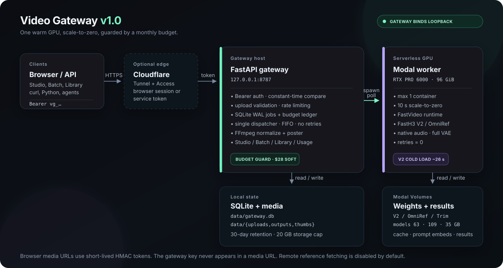

# Architecture



The gateway is a single FastAPI process with SQLite and local media on the
gateway host. It submits at most one job at a time to a scale-to-zero Modal
worker. The browser and API clients never talk to Modal directly; all job state,
budget enforcement and media delivery stay on the gateway.

## Components

```
┌──────────────────────────── Gateway host ───────────────────────────────┐
│  FastAPI gateway (systemd user service or Docker)                        │
│    ├── API key auth, rate limit, upload validation                       │
│    ├── SQLite WAL: videos, batches, uploads, ledger, settings, events    │
│    ├── single dispatcher thread (one Modal job in flight)                │
│    ├── FFmpeg: stream-copy H.264, AAC audio, faststart, poster, probe    │
│    ├── media storage: data/{uploads,outputs,thumbs}                      │
│    └── static SPA: studio, batch, library, usage                         │
│                                                                          │
│  Modal SDK: Function.spawn / FunctionCall.get / Volume.read_file         │
└───────────────────────────────┬──────────────────────────────────────────┘
                                │
┌───────────────────────────────▼──────────────────────────────────────────┐
│  Modal app "video-gateway-worker"                                        │
│    prepare(): CPU-only, 2 cores/8 GiB, downloads checkpoints to Volume   │
│    generate(): RTX PRO 6000, 4 cores/96 GiB, max 1 container, 10s idle   │
│      └── FastVideo VideoGenerator → FastH3 V2 / OmniRef (Trim hidden)   │
│    results Volume: results/{job_id}/{result.json,video.mp4}              │
│    progress Dict: stage/pct, read by the gateway                         │
└──────────────────────────────────────────────────────────────────────────┘
```

## Job state machine

```
queued ──► submitting ──► processing ──► downloading ──► completed
   │            │              │               │
   │            │              ├──► failed     └──► failed (download/postprocess)
   │            │              └──► cancelled
   │            └──► failed (spawn error / interrupted submission, no retry)
   └──► cancelled (before dispatch)
```

- `queued`: persisted with a cold-start budget reservation. No GPU exists.
- `submitting`: claimed by the dispatcher, spawn in progress. The call id is
  written immediately after `spawn` returns.
- `processing`: Modal call id persisted; the dispatcher polls the result volume
  and the call. Progress comes from a Modal Dict updated by the worker.
- `downloading`: result exists; gateway streams the MP4 to local disk.
- `completed`: FFmpeg-normalized, poster made, cost recorded in the ledger.

## Restart and duplicate-billing safety

The important invariant: **a job is never automatically submitted twice**.

1. `modal_call_id` is persisted before polling starts.
2. If the gateway dies after the Modal call is accepted, the row remains
   `processing`; on restart the dispatcher reattaches with
   `FunctionCall.from_id(call_id)` and also checks the result Volume.
3. If the gateway dies between `spawn` and saving the call id, the row is
   `submitting` with no call id. On restart it checks the result Volume:
   - result exists → finalize it;
   - no result and older than 120s → mark failed with an explicit message.
     It is **not** resubmitted.
4. If the Modal app is redeployed and the old call id no longer resolves, the
   result Volume is still checked. If there is no result, the job is failed.
5. `retries=0` at Modal and no retry loop in the gateway.
6. User-initiated "Try again"/`/retry` creates a new job, a new reservation and a
   new billable run. This is explicit in the UI.

## Budget accounting

Two independent numbers:

- **Estimated ledger**: per-job measured function wall time + 10s scaledown +
  8s boot overhead, multiplied by GPU/CPU/RAM rates. Written when a job reaches
  a terminal state. Used for the charts and as the fallback source.
- **Official Modal billing**: `Workspace.billing.summary()` when the plan permits
  it. Stored per cycle. If available, the larger of official and estimated is
  used for admission (official data can lag).
- **Reservations**: every queued/active job holds a cold-start worst-case
  estimate. `remaining = soft_budget - max(official, estimated) - reservations`.

Admission happens at creation and again just before spawn. If the check fails
at spawn, the job returns to `queued` with a visible reason; it is not billed.

Default: `MONTHLY_CREDITS_USD=30`, `MONTHLY_SOFT_BUDGET_USD=28`. The $2 gap is
intentionally left for billing lag, volume storage and egress. The gateway never
raises Modal's usage limit or spend limit.

## SQLite schema (v2)

| Table | Purpose |
|---|---|
| `videos` | Job, owner slot, prompt, dimensions, status, Modal call id, output paths, timings, cost, error, meta JSON |
| `batches` | Batch id, owner slot, created time, model, total, label |
| `uploads` | Input reference provenance (path, MIME, bytes, hash) |
| `ledger` | Billable events, unique per `(video_id, kind)` to avoid double counting |
| `settings` | Billing baseline/cycle/source, manual invoice note |
| `events` | Human-readable lifecycle log for diagnostics |

WAL mode, one connection per operation, `BEGIN IMMEDIATE` for the claim, and a
30s busy timeout. This is deliberately not an ORM.

## Media pipeline

1. Worker writes MP4 (video + audio) to the results Volume.
2. Gateway streams it to `data/tmp/{id}.raw.mp4`.
3. FFmpeg stream-copies the worker's H.264/yuv420p video unchanged, applies
   EBU R128 `loudnorm`, encodes audio to AAC 192 kb/s and moves the moov atom
   with `+faststart`. Non-H.264 sources use a libx264 `preset slow` / CRF 16
   fallback instead of a lossy generation re-encode.
4. FFmpeg extracts a 640px poster at 0.7s.
5. Probe reads duration, dimensions and audio presence from FFmpeg stderr
   (no ffprobe dependency).
6. Raw file deleted; output and poster served with Range support.

If FFmpeg fails, the raw worker MP4 is kept and the job still completes with a
warning, rather than losing a paid render.

## Security boundaries

- The browser never receives the gateway API key in a media URL. Content and
  thumbnail URLs carry purpose-scoped HMAC tokens with a 1h TTL.
- Video and batch rows carry an owner slot derived from the API-key position.
  Library and lifecycle routes are owner-scoped; budget, Usage and the GPU queue
  remain global. The first key is the admin key.
- Uploads are decoded and re-encoded; SVG and remote URLs are rejected by default.
- File paths are UUID-based and deletion is constrained to the data directory.
- The worker has no gateway credentials; it only reads/writes Modal Volumes.
- Gateway binds `127.0.0.1` by default. Public exposure is a TLS reverse-proxy
  decision documented in OPERATIONS.md.

## What was intentionally left out

- Redis/Celery/Kubernetes: one dispatcher thread and SQLite are enough.
- Multi-GPU: one RTX PRO 6000 is the cost/quality sweet spot; multi-GPU adds
  cold-start and scheduling complexity for a personal service.
- Multi-reference character consistency is delegated to the separate
  `fasth3-omniref` route. The default V2 route keeps a single first frame so a
  batch can stay on one warm model.
- A queue UI with priorities: FIFO is predictable and the batch endpoint covers
  the common case.
- Automatic model switching per prompt: it would destroy warm-container reuse.
